# M4-C2 scripted fresh-player Ch1-2 run

Date: 2026-10-13. Tool: `node tools/verify-ch12-run.mjs <port>`.

| AC | Result |
|---|---|
| AC1 all Ch1-2 beats + errands done | FAIL |
| AC2 gear equipped + shown | PASS |
| AC3 save / Continue byte-stable | FAIL |
| AC4 guidance gaps (> 30 s blind) | 0 rows |

## Quests (AC1)

| Quest | Status | Last objective | Forced step |
|---|---|---|---|
| m1 | done | - | - |
| tower.blade | done | - | - |
| burl.boars | done | - | - |
| sq.burl.blue | done | - | - |
| mq.river.road | done | - | - |
| mq.ford.stones | done | - | - |
| mq.bend.call | done | - | - |
| mq.ford.mirror | done | - | - |
| mq.smoke | done | - | - |
| sq.tm.nub | done | - | - |
| sq.burl.boars.n | done | - | - |
| sq.burl.boars.w | done | - | - |
| sq.burl.boars.s | done | - | - |
| sq.burl.meat | active | fetch (item boar.meat) | fetch: cannot get 1 x boar.meat: 0 in pack, pickups tried: [] |
| sq.burl.stone | done | - | - |
| sq.burl.hint | done | - | - |
| sq.burl.tower | done | - | - |
| sq.burl.scout | done | - | - |
| sq.burl.ask | done | - | - |
| sq.burl.walk | done | - | - |
| sq.burl.parcel | unavailable | deliver (deliver boar.meat) | not accepted at burl: {"sq.burl.parcel":"unavailable"} |
| sq.post.spare | unavailable | - | not accepted at post: {"sq.post.spare":"unavailable"} |
| sq.straw | done | - | - |
| sq.rb.shield | done | - | equipped shield by hand (requireEquipped); the real equip flow is not driven here |
| sq.rb.regards | done | - | - |
| sq.rb.road | done | - | - |
| sq.fc.ford | done | - | - |
| sq.fc.smoke | done | - | - |
| sq.fc.cross | done | - | - |
| sq.fc.again | done | - | - |
| sq.tm.gap | done | - | - |
| sq.tm.wood | done | - | - |
| sq.tm.cart | done | - | - |
| sq.rb.lamps | done | - | - |
| sq.rb.rocks | done | - | - |
| sq.rb.parcel | done | - | - |
| sq.he.wallow | done | - | - |
| sq.he.farm | done | - | - |
| sq.dw.bees | done | - | - |
| sq.dw.stones | done | - | - |
| sq.fc.stores | done | - | - |
| sq.fc.caps | active | collect (collect redcap) | collect: cannot get 5 x redcap: 0 in pack, pickups tried: [] |
| sq.fc.well | done | - | - |
| sq.fc.shrine | done | - | - |
| sq.fc.jetty | done | - | - |
| sq.fc.cog | active | deliver (deliver cog) | deliver: cannot get 1 x cog: 0 in pack, pickups tried: [] |
| sq.fc.ask | done | - | - |
| sq.rook.gift | done | - | - |
| sq.wreck.plate | available | fetch (item boar.hide) | giver site gondola has no interactable mapping in the script |
| sq.honey | done | - | - |
| sq.rook.shiny | done | - | - |
| sq.packet | available | deliver (deliver packet) | giver site packet has no interactable mapping in the script |
| sq.burl.fire | active | collect (collect emberpod) | collect: cannot get 3 x emberpod: 0 in pack, pickups tried: ["qp.emberpod1","qp.emberpod2","qp.emberpod3"] |

Steps the script had to feed by hand (the real interaction did not fire by itself; each is a candidate bug):

- AC1 all Ch1-2 beats + errands done: sq.burl.meat=active@fetch (item boar.meat), sq.burl.parcel=unavailable@deliver (deliver boar.meat), sq.post.spare=unavailable@-, sq.fc.caps=active@collect (collect redcap), sq.fc.cog=active@deliver (deliver cog), sq.wreck.plate=available@fetch (item boar.hide), sq.packet=available@deliver (deliver packet), sq.burl.fire=active@collect (collect emberpod)
- AC3b Continue restores position, hearts, items, gear, quick bar, quests, flags: title menu never showed
- E+ sq.burl.meat: fetch: cannot get 1 x boar.meat: 0 in pack, pickups tried: []
- E+ sq.rb.shield: equipped shield by hand (requireEquipped); the real equip flow is not driven here
- E+ sq.fc.caps: collect: cannot get 5 x redcap: 0 in pack, pickups tried: []
- E+ sq.fc.cog: deliver: cannot get 1 x cog: 0 in pack, pickups tried: []
- E+ sq.wreck.plate: giver site gondola has no interactable mapping in the script
- E+ sq.packet: giver site packet has no interactable mapping in the script
- E+ sq.burl.fire: collect: cannot get 3 x emberpod: 0 in pack, pickups tried: ["qp.emberpod1","qp.emberpod2","qp.emberpod3"]
- E+ sq.burl.parcel: not accepted at burl: {"sq.burl.parcel":"unavailable"}
- E+ sq.post.spare: not accepted at post: {"sq.post.spare":"unavailable"}

## Main beats (stills)

| Beat | Game t (s) | Still |
|---|---|---|
| 1 wake in the tower | 0 | 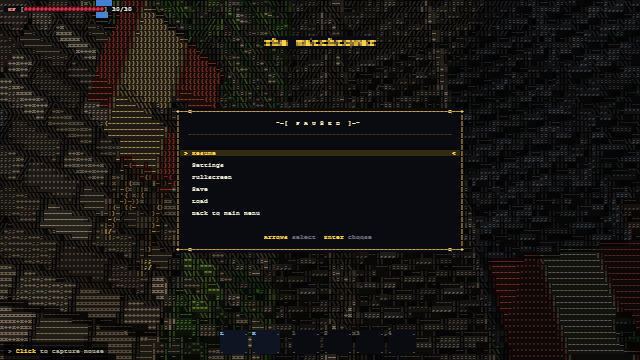 |
| 2 read the note (tower.blade offered/accepted) | 1 | 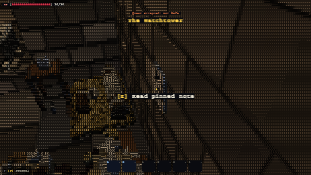 |
| 3 take the sword, leave the tower | 2 | 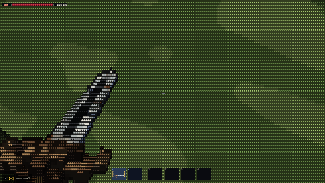 |
| 4 Burl: hand in the blade, boar quest accepted | 3 | 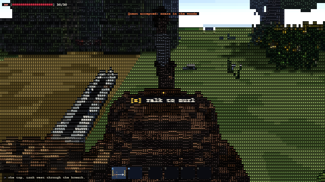 |
| 5 kill the five boars -> burl.boars ready | 4 | 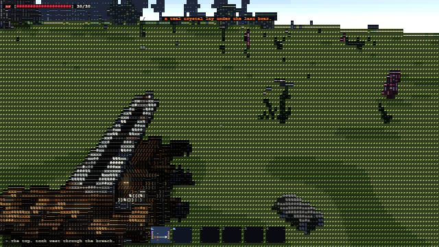 |
| 6 Burl: hand in the boar quest | 5 | 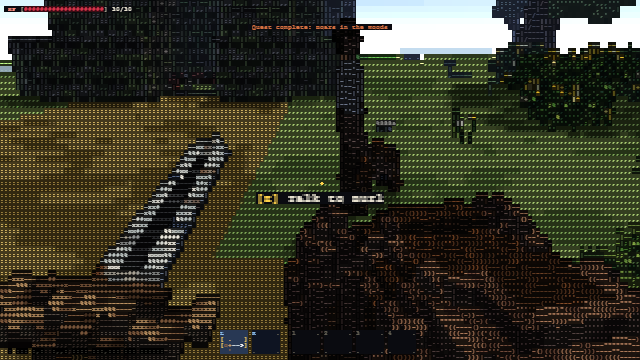 |
| 7 walk to the waystone with Burl (burl.arrived), wake the stone | 6 | 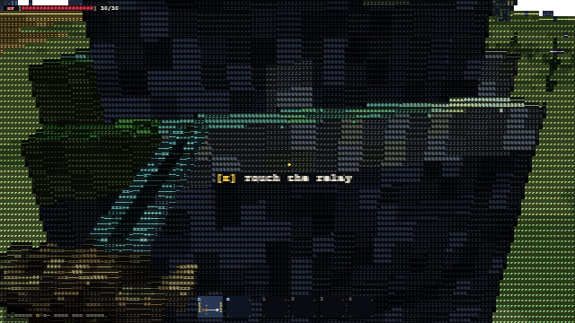 |
| 8 Burl says goodbye and goes home (burl.home) | 7 | 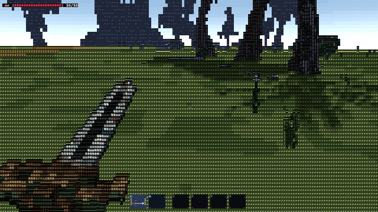 |
| 9 road west + Bend relay found (roadWest, bendRelay) | 8 | 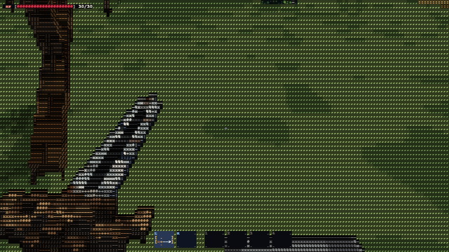 |
| 10 Bend relay wakes (relay1), SOS pulse seen, knot read | 9 | 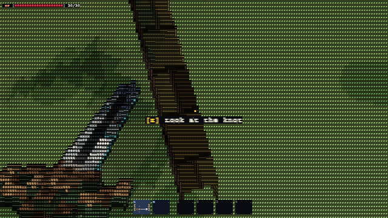 |
| 11 Rook: Bend call (mq.bend.call) accepted + handed in | 10 | 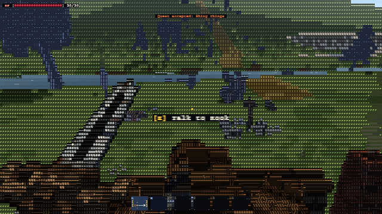 |
| 12 river bank + ford stones (mq.river.road, mq.ford.stones) | 11 | 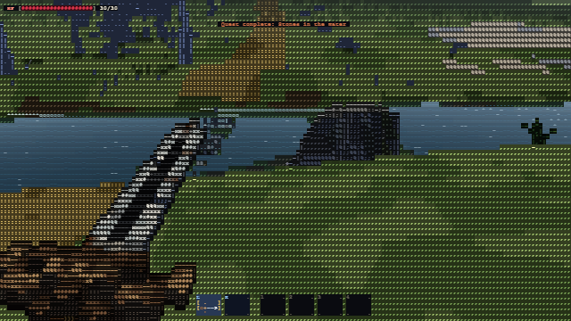 |
| 13 mirror: Rook gives mq.ford.mirror, take relay.mirror from the nest | 12 | 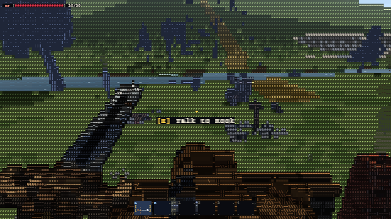 |
| 14 Ford relay wakes -> mq.ford.mirror done | 13 | 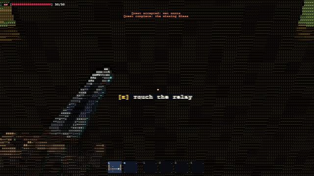 |

## Gear (AC2)

```
{"main":"sword","off":"shield","left":"sword","right":"shield","vm":false}
```

## Guidance-gap table (AC4)

Sampled every 5 s; a row = a stretch longer than 30 s with no tracked HUD objective, no compass target and no ! / ? giver within view range.

No gaps.

## Save compare (AC3)

Identical after Continue.

## Notes

- 138 samples every 5 s of wall time; the script teleports between beats, so the "where" is the spot the player stood at while a beat ran (event = beat name)
- compass column = __debug.compassRetarget() has a target; giver = a ! / ? giver within 30 m
- console errors: 0
